# 🌿 DIRECCIÓN CREATIVA Y ESTRATEGIA DE TURISMO EXPERIENCIAL
## Villa Elena Mirador & Eco-Resort (Paipa, Boyacá)
**Documento Estratégico Maestro de Marca, Curaduría Audiovisual, Matriz Experiencial y Arquitectura de Conversión**  
**Versión:** 1.0.0 (Master Creative Blueprint)  
**Autoridad:** Dirección Creativa & Estrategia de Turismo Experiencial (Antigravity 2026)  
**Destino:** Landing Page Oficial & Experiencias Villa Elena Mirador  

---

## 1. Posicionamiento Estratégico: "Punto Turístico, de Descanso y de Pasadías Diferente"

### 1.1. Diagnóstico del Ecosistema Turístico de Paipa y Boyacá
Paipa ha sido históricamente reconocida por dos productos maduros:
1. **Turismo termal y hotelero convencional:** Hoteles masivos de congresos y piscinas termales públicas con alta congestión, ruido y baja personalización.
2. **Glampings de primera generación:** Domos geodésicos o cabañas aisladas que operan como "habitaciones de hotel dispersas en el campo", carentes de narrativa, donde el huésped llega a las 16:00, no tiene nada que hacer salvo mirar el celular o una pantalla, cena comida rápida recalentada y se marcha a las 11:00 am sintiendo vacío experiencial.

### 1.2. La Tesis Diferenciadora de Villa Elena Mirador
> **"No vendemos una cama en la montaña; facilitamos una pausa transformadora de 24 horas y pasadías vivos que reconcilian al ser humano con el silencio, la tierra y el firmamento andino."**

Villa Elena Mirador redefine el concepto de hospitalidad rural en Boyacá bajo cuatro ejes irreplicables:

1. **Ubicación Panorámica Soberana (2.525 msnm):**
   - Balcón natural sobre el **Lago Sochagota**, las colinas de Paipa y la cuenca de la **Laguna Sagrada de Marcura**.
   - Proximidad estratégica inmejorable: a solo **12 minutos del centro de Paipa** por vía pavimentada y placa huella para todo tipo de vehículos, pero con el aislamiento acústico y la paz de la alta montaña.

2. **La Doble Vocación Operativa (Pasadías Conscientes vs. Estancias 24 Horas):**
   - **El Pasadía Diferente:** Rompe con la fricción del paseo de olla o el asado pesado. En Villa Elena el visitante dispone de un *Mise en Place* campesino de alta calidad (carnes marinadas, papa sabanera al dente en sal Elimani, mazorca caramelizada, guacamole Hass), talleres de amasijos en tiesto de barro, cata de Queso Paipa D.O., y actividades artísticas (*Sip & Paint*) sin necesidad de empacar maletas ni pernoctar.
   - **La Estancia 24 Horas ("Ciclo Circadiano Completo"):** Una experiencia secuenciada que acompaña el ritmo de la luz solar y las estrellas (llegada con infusión de huerto -> aromaterapia andina -> atardecer dorado sobre el lago -> fuego, canelazo y astroturismo muisca -> sueño reparador en lencería térmica -> yoga o reiki al amanecer -> desayuno campesino consciente -> baño de bosque y siembra de árbol nativo *Deja tu Huella*).

3. **Raigambre Cultural Muisca & Identidad Boyacense Viva:**
   - La experiencia honra el territorio sagrado de Marcura. No es folclore impostado; es la presencia viva de **Doña Marleny** y los anfitriones locales compartiendo el secreto de la arepa en tiesto de barro, la historia de los frailejones del Páramo de la Ranchería y la lectura del cielo estelar que guiaba las cosechas indígenas.

4. **Regeneración Activa vs. Ecoturismo Pasivo:**
   - A través del programa **"Deja tu Huella"**, cada visitante o pareja puede plantar un árbol nativo (Arrayán, Aliso o Hayuelo) con placa conmemorativa grabada, transformando su visita en un acto restaurador del corredor biológico Laguna de Marcura - Páramo de la Ranchería.

---

## 2. Curaduría y Mapeo de Activos Audiovisuales (MATERIAL AV)

El acervo audiovisual de Villa Elena Mirador comprende más de 200 piezas fotográficas de alta resolución, tomas aéreas con dron y secuencias de inmersión. A continuación se define la selección maestra por módulo narrativo para la Landing Page:

```mermaid
flowchart TD
    subgraph ActivosAV ["MATERIAL AV - CURADURÍA NARRATIVA"]
        Dron["assets/videos/video_aereo_villa_elena.mp4\n(Video Hero & Escala Territorial)"]
        Lago["assets/curated/hero_vista_lago.jpeg\n(Mirador al Lago Sochagota)"]
        Atardecer["assets/curated/salon_atardecer.jpeg\n(Golden Hour & Salón Social)"]
        Domo["assets/curated/glamping_domo.jpeg\n(Arquitectura Geodésica)"]
        Carpas["assets/curated/carpa_fija_interior.jpeg\n(Confort Safari & Lencería)"]
        Astroturismo["assets/curated/camino_luces_astroturismo.jpeg\n(Cielos Nocturnos & Luces)"]
        Picnic["assets/curated/picnic_laguna.jpeg\n(Gastronomía & Laguna de Marcura)"]
        Yoga["assets/curated/yoga_mirador.jpeg\n(Práctica Holística frente al Lago)"]
        Gente["assets/images/experiencias_186_Doña_Marleny.jpeg\n(Hospitalidad Cálida de Origen)"]
    end

    Dron --> HeroSection["1. HERO INMERSIVO: 'Vuela sobre el Refugio'"]
    Lago --> HeroSection
    Domo --> AlojamientosSec["2. ALOJAMIENTO: Lujo Rústico & Domos"]
    Carpas --> AlojamientosSec
    Yoga --> BienestarSec["3. BIENESTAR: Cuerpo, Mente & Spa"]
    Astroturismo --> AstroSec["4. NOCHE MUISCA & ASTROTURISMO"]
    Picnic --> GastronomiaSec["5. GASTRONOMÍA & BBQ MISE EN PLACE"]
    Atardecer --> PasadiasSec["6. PASADÍAS & SALÓN DE ENCUENTROS"]
    Gente --> HistoriaSec["7. FACTOR HUMANO: La Esencia de Doña Marleny"]
```



### 2.1. Fichas de Curaduría de Activos Clave

| ID Activo / Ubicación | Escena / Elemento Visual | Emoción Provocada | Asignación en la Landing Page |
|---|---|---|---|
| `assets/videos/video_aereo_villa_elena.mp4` (9.52 MB) | Vuelo suave de dron revelando la cresta montañosa, la terraza mirador, los domos entre árboles nativos y el espejo del Lago Sochagota al fondo. | Asombro, escala monumental, deseo de escape, exclusividad natural. | **Hero Background Video** con fallback a imagen, y botón con micro-modal *"Ver recorrido aéreo (45s)"*. |
| `assets/curated/hero_vista_lago.jpeg` | Vista panorámica frontal en alta definición del Lago Sochagota con cielo azul y vegetación verde esmeralda. | Serenidad, aire puro, desconexión inmediata del smog urbano. | **Hero Primary Visual** & OpenGraph / Twitter Cards principales. |
| `assets/curated/salon_atardecer.jpeg` (`mirador_179`) | El sol tiñe de dorado y magenta el horizonte sobre las montañas; ventanales amplios del salón social y terraza con copas. | Calidez, romance, celebración de fin de tarde, elegancia rústica. | Encabezado de la sección **Pasadías & Salón de Eventos** / Galería Destacada. |
| `assets/curated/glamping_domo.jpeg` (`domo_45`) | Domo geodésico perfectamente integrado en la ladera verde, con ventanal cenital y deck frontal de madera. | Curiosidad arquitectónica, modernidad ecológica, romanticismo estelar. | Tarjeta del **Glamping Domo Geodésico** y paquete estelar. |
| `assets/curated/carpa_fija_interior.jpeg` (`camping_71`) | Cama matrimonial generosa, almohadas mullidas, lencería de tonos tierra y cobijas abrigadas con luz tenue acogedora. | Refugio, protección contra el frío boyacense, intimidad reparadora. | Tarjeta de **Carpas Fijas Confort** (Elimina el miedo al "camping incómodo"). |
| `assets/curated/carpa_fija_noche.jpeg` (`camping_121`) | Carpa iluminada desde el interior brillando como linterna en la oscuridad de la noche andina. | Magia, aventura segura, intimidad bajo las constelaciones. | Galería nocturna / Sección de Alojamiento Confort. |
| `assets/curated/camino_luces_astroturismo.jpeg` (`camping_114`) | Sendero rústico bordeado de pequeñas luces cálidas guiando la mirada hacia la fogata y el cielo abierto. | Guía, misterio acogedor, expectativa de contemplar las estrellas. | Sección **Astro-Turismo & Noche Muisca con Telescopio**. |
| `assets/curated/yoga_mirador.jpeg` (`bienestar_154`, `bienestar_176`) | Silueta en postura de yoga o meditación sobre el deck de madera, con el lago y la bruma matinal de fondo. | Equilibrio, salud integral, presencia consciente, respiración pura. | Sección **Bienestar, Mente & Spa Holístico**. |
| `assets/curated/spa_holistico.jpeg` (`bienestar_144`) | Mascarillas botánicas, elementos de la huerta viva, toallas blancas y copas de mimosa en ambiente relajado. | Autocuidado, complicidad femenina, relajación sin pretensiones. | Tarjeta de **Beauty & Wine Social Spa** / Paquete Santuario de Chicas. |
| `assets/curated/picnic_laguna.jpeg` (`gastronomia_164`, `gastronomia_157`) | Mantel campesino extendido frente al agua, canasta de mimbre, frutas frescas, quesos artesanales y copas de vino. | Placer pausado, comunión con la naturaleza, momentos instagrameables reales. | Sección **Gastronomía de Autor & Picnics al Atardecer**. |
| `assets/curated/cena_maridaje.jpeg` (`gastronomia_175`) | Mesa servida con vajilla rústica, tabla de Queso Paipa D.O., frutos secos y copas de vino bajo iluminación cálida. | Sofisticación campesina, placer sensorial, homenaje a la Denominación de Origen. | Experiencia **Cata de Queso Paipa & Maridaje Sunset**. |
| `assets/images/general_3_Doña_Marleny.jpeg` (`experiencias_186`) | Rostro sonriente y noble de Doña Marleny con delantal tradicional, transmitiendo acogida familiar y sabiduría. | Confianza absoluta, hospitalidad sincera, calidez de hogar boyacense. | Sección **"Nuestra Esencia"** / Hospitalidad Local. |
| `assets/curated/ritual_bienvenida.jpeg` (`experiencias_194`, `experiencias_118`) | Huéspedes recibiendo la infusión aromática en vasijas de barro con una sonrisa de bienvenida. | Sensación de haber llegado a casa, acogida ritual, inicio de la desconexión. | Módulo **Itinerario 24 Horas: Paso 1**. |
| `assets/curated/paseo_caballo.jpeg` (`experiencias_191`) | Huésped a caballo recorriendo los senderos veredales con vista al horizonte boyacense. | Libertad, conexión animal, tradición ecuestre pacífica. | Actividad complementaria en catálogo. |
| `assets/curated/ganzos_granja.jpeg` (`general_6`) & `experiencias_57` | Gansos y gallinas libres en la pradera verde interactuando con los visitantes. | Inocencia, contacto con la vida de granja, ideal para familias con niños. | Módulo de **Experiencias Familiares & Granja Consciente**. |
| `assets/curated/juegos_pasadia.jpeg` (`general_201_triqui`) | Triqui gigante tallado en madera sobre el pasto verde, hamacas al fondo. | Alegría compartida, desconexión de pantallas, juego analógico. | Módulo **Pasadía & Zona BBQ**. |

---

## 3. Matriz de Experiencia Comparativa: Pasadías y Estancias 24 Horas

### 3.1. Glamping Tradicional vs. Villa Elena Mirador

| Dimensión Experiencial | Oferta Tradicional en Paipa / Boyacá | Villa Elena Mirador (La Diferencia) |
|---|---|---|
| **Propósito de la Estancia** | Ocupación de cama ("Dormir en un domo"). | **Ruta de Reconexión de 24 Horas:** Un ciclo integral guiado para "mirar hacia adentro y reconectar con lo que realmente importa". |
| **Pasadías** | Inexistente o limitado a pedir prestado un baño para caminar por el campo. | **Pasadía Estructurado de Alto Valor:** Zona BBQ privada con *Mise en Place* listo, talleres artesanales, juegos rústicos gigantes y mirador al lago. |
| **Gastronomía** | Comida rápida pedida por domicilio desde el pueblo que llega fría, o carbón apagado por lluvia. | **Terruño & Respaldo:** Mise en place parrillero con lomo marinado y embutidos de origen, cata de Queso Paipa D.O., y taller de arepas en tiesto. |
| **Noche & Entretenimiento** | Televisor con streaming o silencio incómodo sin actividades. | **Cosmovisión Muisca & Astroturismo:** Noche guiada con telescopio computarizado, canelazo al fuego y leyendas de Marcura. |
| **Mañana & Despertar** | Desalojo apresurado a las 11:00 am con café recalentado. | **Ritual del Alba:** Yoga/Reiki con bruma sobre el lago, desayuno campestre consciente y check-out extendido a las 13:00. |
| **Impacto Ambiental** | Generación de residuos plásticos sin vinculación ecológica. | **Turismo Regenerativo:** Programa "Deja tu Huella" (siembra de árbol nativo con placa personalizada grabada). |

---

### 3.2. Matriz de Secuenciación: El Ciclo de 24 Horas de Bienestar

```
  15:00 hrs          16:30 hrs           18:00 hrs           20:00 hrs           22:00 hrs
  [LLEGADA] -------- [RESPIRA] --------- [SABOREA] --------- [DESCUBRE] -------- [DESCANSA]
  Infusión fría/     Aromaterapia de     Picnic Gourmet      Fogata con         Jacuzzi privado,
  caliente de        menta, romero y     & Cata Queso        Canelazo & Noche   lencería térmica
  huerta en el       lavanda frente      Paipa D.O. viendo   Astronómica con    y silencio de
  Mirador.           al lago.            el atardecer.       Telescopio.        montaña.

  07:30 hrs          08:30 hrs           10:00 hrs           12:00 hrs           13:00 hrs
  [DESPIERTA] ------ [NUTRE] ----------- [CAMINA] ---------- [TRASCsplice] ----- [DESPIDE]
  Yoga o Reiki con   Desayuno campestre  Baño de bosque      Siembra de árbol   Check-out pausado
  vista al Lago      consciente con      hacia la Laguna     nativo "Deja tu    con regalo
  Sochagota.         huevos de campo.    de Marcura.         Huella".           botánico.
```

---

### 3.3. Matriz de Pasadías: "El Día Perfecto sin Empacar Maletas"

| Módulo de Pasadía | Experiencia y Contenido | Por qué es diferente | Activo Audiovisual Clave |
|---|---|---|---|
| **Pasadía BBQ Parrillero** | Alquiler de parrilla con carbón listo + *Mise en place* de lomo fino, cerdo marinado, chorizo boyacense, morcilla, papas sabaneras al vapor con sal Elimani, mazorcas dulces con mantequilla de ajo y guacamole fresco. | Cero estrés de compras previas en supermercados ni carnes mal refrigeradas en el baúl del carro. Todo llega porcionado a temperatura ideal. | `assets/curated/salon_atardecer.jpeg` + Video BBQ |
| **Pasadía Sabores & Arte (Sip & Paint + Arepas)** | Taller práctico de cocina ancestral (amasar y asar arepas en tiesto) + sesión de pintura en lienzo al aire libre con 2 copas de vino y atardecer frente al lago. | Estimula la creatividad, la risa compartida y rescata el sabor ancestral boyacense en manos de los propios visitantes. | `assets/curated/cena_maridaje.jpeg` + `assets/curated/brindis_experiencias.jpeg` |
| **Pasadía Social Spa & Chicas** | Salón social privado, beauty spa con mascarillas faciales orgánicas del huerto, exfoliación botánica, mimosas frías, picnic decorado y sesión de biodanza o yoga suave. | Alternativa prémium a los concurridos baños termales públicos; privacidad, elegancia campestre y conexión íntima entre amigas o familias. | `assets/curated/spa_holistico.jpeg` + `assets/curated/picnic_laguna.jpeg` |

---

## 4. Arquitectura de Copywriting Persuasivo y Llamadas a la Acción (CTA)

### 4.1. Tono de Voz y Principios de Redacción
- **Voz de Marca:** Poética pero terrenal, hospitalaria como una abuela boyacense, precisa como un telescopio astronómico, sofisticada sin tecnicismos fríos.
- **Tensión Emocional a Resolver:** *"Vivo corriendo, abrumado por notificaciones, en trancones y respirando prisa. Necesito un lugar real donde no me traten como un número y donde el silencio me devuelva la calma."*
- **Palabras Clave de Poder:** *Silencio andino, reconexión, fuego sagrado, firmamento, de origen, tiesto de barro, aire puro, pausa viva, 2.525 metros, sin afán.*

---

### 4.2. Copywriting por Secciones de la Landing Page

#### Section 1: Hero Section (Impacto & Resonancia Inmediata)
- **Pre-Título (Eyebrow):** `Paipa, Boyacá • 2.525 msnm • Mirador al Lago Sochagota`
- **Titular Principal (H1):**  
  `Un espacio para mirar hacia adentro y reconectar con lo que realmente importa.`
- **Subtítulo Narrativo:**  
  *Lejos del tráfico y el afán cotidiano, te espera un balcón natural sobre el Lago Sochagota. Vive 24 horas continuas de glamping de alta gama, observación astronómica con telescopio, senderismo sagrado a Marcura y gastronomía campesina de origen.*
- **Llamadas a la Acción (CTAs):**
  - Botón Primario: `[ Explorar Alojamientos & Domos ]` (ancla suave a `#alojamiento`)
  - Botón Secundario: `[ Ver Paquetes de 24 Horas ]` (ancla suave a `#paquetes`)
  - Micro-interacción: `[ ▷ Ver Video del Mirador (45s) ]` (lanza modal con `assets/videos/video_aereo_villa_elena.mp4`)
- **Puntos de Prueba (Trust Signals):**
  - *2.525 m de altitud pura* | *Vista 100% despejada al lago* | *Cata de Queso Paipa D.O.* | *Jacuzzi privado con agua caliente*

---

#### Section 2: Alojamientos (Lujo Rústico y Confort Térmico)
- **Encabezado:** `Refugios Diseñados para el Descanso Profundo`
- **Subtítulo:** `Desde suites con jacuzzi panorámico hasta domos geodésicos bajo las estrellas y carpas confort. Todo con camas vestidas, lencería térmica y el murmullo del viento andino.`

##### Microcopys por Tipo de Hospedaje:
1. **Glamping Mirador Suite 1 & 2 ($280.000 COP / pareja):**
   - *Titular de impacto:* *"El calor del jacuzzi privado mientras el atardecer apaga el Lago Sochagota."*
   - *Bullet persuasivo:* Cama queen ortopédica, calefacción, deck privado de madera y desayuno campesino servido a la mesa.
   - *CTA:* `[ Cotizar Suite con Jacuzzi ]`

2. **Glamping Domo Geodésico ($220.000 COP / pareja):**
   - *Titular de impacto:* *"Dormir bajo la cúpula celeste y despertar con la bruma de las montañas."*
   - *Bullet persuasivo:* Arquitectura sagrada con ventanal panorámico cenital, baño privado y cobijas térmicas de alto gramaje.
   - *CTA:* `[ Cotizar Domo Estelar ]`

3. **Carpas Fijas Confort ($150.000 - $180.000 COP / pareja):**
   - *Titular de impacto:* *"La autenticidad de acampar, con la comodidad de una cama matrimonial vestida."*
   - *Bullet persuasivo:* Montadas sobre plataformas elevadas de madera, con electricidad, iluminación ambiental y baterías sanitarias impecables con ducha caliente 24h.
   - *CTA:* `[ Cotizar Carpa Fija ]`

4. **Camping con Dotación o Libre ($30.000 - $60.000 COP / persona):**
   - *Titular de impacto:* *"Aventura sin equipaje pesado: llegas y tu carpa ya está armada y equipada."*
   - *CTA:* `[ Reservar Espacio de Camping ]`

---

#### Section 3: La Experiencia BBQ sin Fricción (El Pasadía Gastronómico)
- **Encabezado:** `El Placer de Parrillar sin Compras, Bolsas ni Complicaciones`
- **Subtítulo:** `Tú solo pones el antojo y la compañía; nosotros disponemos la parrilla, el carbón vegetal y el mise en place artesanal listo para asar.`
- **Copy de Apertura del Menú:**
  *"Olvídate de hacer filas en el supermercado, cargar neveras de icopor o preocuparte si la carne está marinada. En Villa Elena te entregamos cortes seleccionados de res y cerdo atemperados, chorizos y morcillas de tradición boyacense, papas sabaneras en sal Elimani y guacamole recién macerado con aguacate Hass. El fuego ya está listo."*
- **Tarifas Claras y Transparentes:**
  - *Pasadía BBQ Grupal (5 personas):* $175.000 COP
  - *Pasadía BBQ Grupal (10 personas):* $341.000 COP
  - *Tarifa individual:* $35.000 COP (incluye refrescante preparada tradicional de panela con limón)
- **CTA:** `[ Cotizar Pasadía Parrillero con Mise en Place ]`

---

#### Section 4: Experiencias a la Carta (Los 5 Sentidos en Boyacá)
- **Filtros Interactivos:**
  - `Todos` | `Naturaleza & Ecoturismo` | `Astro-Turismo & Noche` | `Gastronomía de Origen` | `Bienestar & Spa` | `Cultura Local`
- **Copys Destacados:**
  - *Cata de Queso Paipa D.O. & Vino:* *"Tres tiempos de maduración del único queso protegido de Colombia, maridado con vino reserva y el sol hundiéndose en el lago."*
  - *Noche Muisca & Telescopio:* *"Un viaje de 2 horas al centro del cielo andino. Conoce las historias de Marcura alrededor del fuego y observa los anillos de Saturno."*
  - *Beauty & Wine Social Spa:* *"Mascarillas de arcilla y plantas recolectadas en la huerta viva, mimosas bien frías y risas compartidas en un salón privado."*
  - *Taller de Arepa en Tiesto:* *"Aprender a moler el maíz, sentir la masa con cuajada campesina y oler el barro caliente sobre la leña. Boyacá en el paladar."*

---

#### Section 5: Paquetes 24 Horas "Ciclo Completo" (Alta Conversión)
- **Copy de Conversión:**
  *"Un paquete no es un descuento; es la certeza de que tu fin de semana está completamente resuelto por anfitriones expertos para que tú no tengas que planear nada."*

##### Las 3 Propuestas Estrella:
1. **Paquete 1: Desconexión & Reconexión Integral ($590.000 COP / pareja)**
   - *Promesa:* Jacuzzi privado + aromaterapia + picnic gourmet con cata de Queso Paipa + noche de telescopio y canelazo + yoga matutino + desayuno campesino + siembra de árbol nativo "Deja tu Huella".
   - *CTA:* `[ Reservar Escapada de 24 Horas para Pareja ]`

2. **Paquete 2: Fuego, Estrellas & Sabores ($210.000 COP / persona - Mín. 4 pers)**
   - *Promesa:* Pasadía extendido (12h a 24h) con taller de arepa en tiesto + taller artístico Sip & Paint + atardecer en el mirador + asado chileno & vino bajo las estrellas + historias y telescopio nocturno.
   - *CTA:* `[ Cotizar Plan Amigos & Familia ]`

3. **Paquete 3: Santuario de Chicas & Spa Holístico ($220.000 - $250.000 COP / persona)**
   - *Promesa:* Carpas fijas o glamping + sesión Beauty & Wine Spa (mascarillas y mimosas) + cine bajo las estrellas o fogata + desayuno saludable + yoga/biodanza + caminata a la laguna + almuerzo picnic decorado.
   - *CTA:* `[ Cotizar Encuentro de Chicas & Cumpleaños ]`

---

#### Section 6: El Motor de Cotización Instantánea (Frictionless Booking)
- **Titular del Cotizador:** `Arma tu Experiencia a la Medida en Segundos`
- **Microcopy de Confianza:**  
  *Selecciona tus fechas, agrega los servicios que deseas y obtén el cálculo exacto en pesos colombianos (COP). Sin comisiones ocultas de plataformas internacionales; reserva directa y atención personalizada vía WhatsApp oficial.*
- **Llamadas a la Acción en el Modal de Cotización:**
  - `[ Continuar a Reserva por WhatsApp ]` -> Envía el desglose completo pre-formateado al equipo de Villa Elena con nombres, fechas, desglose ítem por ítem y total.
  - `[ Descargar Resumen en PDF / Copiar Cotización ]`

---

## 5. Recomendaciones de Implementación para el Equipo de Desarrollo

1. **Alineación con el Atelier Design System:**
   - Mantener rigurosamente la paleta monocromática cálida (`#FBFBFD`, `#F5F5F7`, acentos en Verde Bosque `#2D4A3E` y Terracota Arcilla `#9C4A2F`).
   - Cero librerías externas de iconos o emojis en botones de acción; exclusividad de **Lucide Icons** (`stroke-width="1.5"`).

2. **Aprovechamiento del Video Dron (`video_aereo_villa_elena.mp4`):**
   - Implementar un botón flotante sutil en el Hero: `[ ▷ Ver recorrido aéreo ]` que abra un lightbox liviano en HTML5 `<video controls playsinline>` con compresión optimizada.

3. **Optimización SEO Local & Búsqueda Semántica de IA:**
   - Respaldo de Schema.org (`LodgingBusiness`, `TouristAttraction`, `OfferCatalog`, `FAQPage`) ya configurado en el código fuente.
   - Fortalecer los párrafos introductorios con las entidades geográficas clave: *Paipa, Boyacá, Lago Sochagota, Vereda Marcura, Páramo de la Ranchería, Queso Paipa Denominación de Origen*.

4. **Automatización de Respuestas de WhatsApp:**
   - La cadena serializada de WhatsApp en `app.js` debe responder con fluidez al anfitrión, facilitando los datos bancarios para el pago del 50% de anticipo.

---

> **Conclusión del Director Creativo:**  
> Villa Elena Mirador posee todos los atributos visuales, gastronómicos y espirituales para ser el referente indiscutible del nuevo turismo consciente en Boyacá. La combinación de material audiovisual real, tarifas transparentes y una narrativa de bienestar 24 horas convertirá a la Landing Page en un motor de reservas continuas y leales.
