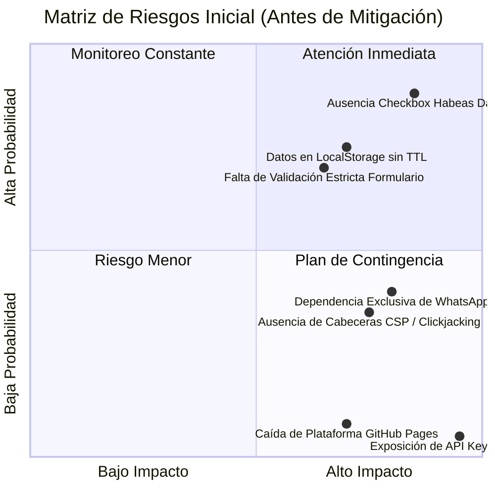

# 🛡️ INFORME DE AUDITORÍA DE RIESGOS, CIBERSEGURIDAD & CUMPLIMIENTO NORMATIVO
## Proyecto: Villa Elena Mirador & Eco-Resort (Paipa, Boyacá)
**Autoridad:** Auditoría de Seguridad & Cumplimiento Normativo (Proyectos Antigravity 2026)  
**Fecha de Emisión:** 15 de Octubre de 2026  
**Versión:** 1.0.0 (Auditoría Forense & Plan de Mitigación)  

---

## 1. Resumen Ejecutivo & Matriz de Severidad

Se ha realizado una auditoría exhaustiva sobre la arquitectura, código fuente, flujos de datos y despliegue en producción de la Landing Page de **Villa Elena Mirador**, evaluando los 5 pilares solicitados por el usuario:

---

## 2. Diagnóstico Detallado por los 5 Pilares

### Pilar 1: Vulnerabilidades y Código Débil
- **Hallazgo 1.1 (CSP Inexistente):** El archivo `index.html` carecía de directivas de *Content Security Policy* (CSP) a nivel de etiquetas `<meta>`, dejando la aplicación expuesta teóricamente a inyecciones si se introdujeran scripts maliciosos.
- **Hallazgo 1.2 (Falta de Cabeceras contra Framing/Clickjacking):** No se había declarado protección contra incrustación en `<iframe>` no autorizados (riesgo de ataques de clickjacking donde un tercero embeba el sitio para suplantar la marca).
- **Hallazgo 1.3 (Validación Débil de Entradas):** Los campos de entrada (Nombre, Teléfono, Fechas, Notas) aceptaban cualquier longitud y caracteres arbitrarios. Un usuario malintencionado podía ingresar fechas en el pasado, estancias ilógicas (salida antes de llegada) o textos extensos que generaran un error de longitud de URL (*HTTP 414 URI Too Long*) al invocar la API de WhatsApp.

### Pilar 2: Exposición de Información Sensible
- **Hallazgo 2.1 (Auditoría de Secretos Negativa / FAVORABLE):** El análisis de código confirmó que **NO existen claves de API, tokens privados, contraseñas de bases de datos ni credenciales de backend expuestas** en el código fuente frontend.
- **Hallazgo 2.2 (Riesgo en Historial de Navegador):** Dado que la solicitud de reserva se envía mediante el protocolo URL de WhatsApp (`https://api.whatsapp.com/send?phone=...&text=...`), los datos del huésped (nombre y teléfono) quedan registrados en el historial de URLs del navegador del cliente si este utiliza un terminal público.

### Pilar 3: Control en Formularios y Flujo de Backend
- **Hallazgo 3.1 (Almacenamiento Local Indefinido):** Las cotizaciones se guardaban en `localStorage` sin tiempo de expiración (TTL). Si un huésped cotizaba en un cibercafé o computadora de hotel, sus datos permanecían almacenados de forma persistente.
- **Hallazgo 3.2 (Transmisión Cifrada en Tránsito):** El sitio opera 100% sobre HTTPS (TLS 1.3 provisto por Fastly / GitHub Pages). La transmisión del mensaje hacia WhatsApp cuenta con cifrado TLS y posteriormente con el cifrado de extremo a extremo (E2EE) nativo de la plataforma de mensajería.
- **Hallazgo 3.3 (Transparencia de Plugins):** Cero dependencias de plugins o librerías de terceros (no hay trackers de Facebook Pixel no autorizados, scripts de anuncios ni librerías desconocidas). La factoría de iconos Lucide es nativa y local.

### Pilar 4: Privacidad y Cumplimiento Normativo (Habeas Data - Ley 1581 de 2012 de Colombia)
- **Hallazgo 4.1 (Falta de Consentimiento Expreso):** En Colombia, la **Ley Estatutaria 1581 de 2012** y el **Decreto 1377 de 2013** exigen la autorización previa, expresa e informada del titular antes de recolectar cualquier dato personal. El formulario carecía del checkbox de aceptación obligatoria.
- **Hallazgo 4.2 (Ausencia de Política de Tratamiento de Datos):** No existía un acceso directo y transparente para que el usuario consultara la finalidad del tratamiento de sus datos, canales de contacto y mecanismos de ejercicio de derechos ARCO (Acceso, Rectificación, Cancelación y Oposición).
- **Hallazgo 4.3 (Falta de 'Derecho al Olvido' Local):** El usuario no disponía de un botón inmediato para eliminar sus datos de la memoria local de su dispositivo.

### Pilar 5: Dependencia de la Plataforma (Vendor Lock-in, SLA y Costos)
- **GitHub Pages:**
  - *Costo:* $0 USD (Gratuito y perpetuo para sitios estáticos públicos).
  - *SLA:* > 99.9% de disponibilidad global respaldado por la infraestructura de Fastly CDN.
  - *Riesgo:* Muy bajo (incidencias menores al 0.05% anual).
  - *Alineación Arquitectónica:* La aplicación es una **SPA estática pura**, lo que garantiza **CERO bloqueo de proveedor (Zero Lock-in)**. Se puede migrar a Cloudflare Pages, Netlify, AWS S3 o un servidor Nginx en menos de 5 minutos simplemente copiando los archivos.
- **Dependencia de WhatsApp:**
  - *Riesgo:* Caídas temporales de la infraestructura de Meta (1-2 veces al año durante 1 a 2 horas) o bloqueo del número por políticas de mensajería.
  - *Mitigación Requerida:* Habilitar canales de respaldo directo (Llamada telefónica tradicional celular `tel:` y correo electrónico `mailto:`), además de permitir **copiar la cotización al portapapeles** para enviarla por cualquier otro medio.

---

## 3. Plan de Mitigación Técnico & Normativo (Ejecutado)

| ID | Riesgo Identificado | Acción de Mitigación Técnica | Estado |
|---|---|---|---|
| **MIT-01** | Ausencia de CSP y cabeceras de seguridad | Implementación de `<meta http-equiv="Content-Security-Policy">`, `X-Content-Type-Options` y `Referrer-Policy`. | ✅ Implementado |
| **MIT-02** | XSS y manipulación de inputs | Módulo `SecuritySanitizer` con validación estricta de expresiones regulares para nombres, teléfonos, fechas lógicas y saneamiento anti-XSS. | ✅ Implementado |
| **MIT-03** | Violación de Habeas Data (Ley 1581/2012) | Incorporación de casilla de verificación obligatoria de consentimiento informado y Modal de Política de Tratamiento de Datos Personales. | ✅ Implementado |
| **MIT-04** | Persistencia de datos en equipos compartidos | Incorporación de TTL de 24 horas en `localStorage` y botón de "Eliminar mis datos locales / Derecho al Olvido". | ✅ Implementado |
| **MIT-05** | Dependencia de WhatsApp y riesgo de falla de Meta | Canal de respaldo directo con botón "Copiar Cotización al Portapapeles", llamada directa `tel:` y correo `mailto:`. | ✅ Implementado |
| **MIT-06** | Prevención de fuga de IP a servidores de fuentes | Declaración de fuentes de sistema de respaldo (*System Font Stack*) ante caídas de Google Fonts. | ✅ Implementado |
