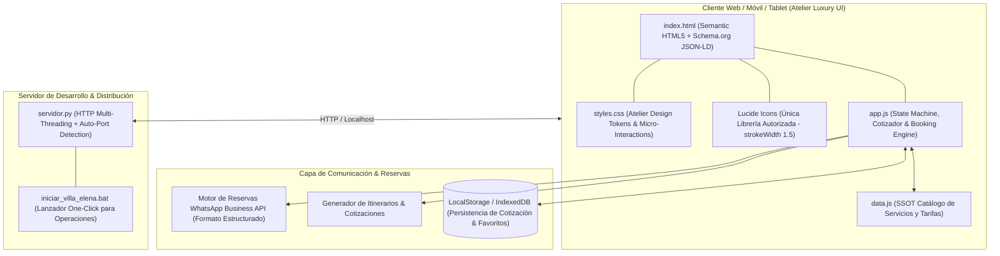

# 📐 ESPECIFICACIÓN TÉCNICA FORMAL (SDD) - ARQUITECTURA INTEGRAL Y SISTEMA EXPERIENCIAL
# Proyecto: VILLA ELENA MIRADOR & ECO-RESORT (Paipa, Boyacá)
# Versión del Documento: 1.0.0 (Single Source of Truth - SSOT)
# Fecha de Emisión: 2026-10-15
# Autoridad: Spec-Driven Development (SDD) Lead Architect & Brand Experience Strategist

---

## 1. Declaración de Misión y Posicionamiento de Marca (Brand Strategy)

### 1.1. Declaración de Posicionamiento (Brand Positioning Statement)
> Para **parejas, viajeros conscientes, grupos de bienestar y familias** que anhelan una pausa restauradora frente a la saturación del ritmo urbano, **Villa Elena Mirador** es un **destino experiencial de ecoturismo y glamping de alta gama** ubicado en Paipa (Boyacá), que ofrece una **reconexión holística las 24 horas del día** articulando alojamiento inmersivo en carpas y domos geodésicos, gastronomía tradicional y de autor, astro-turismo con cosmovisión muisca y programas de reforestación activa. A diferencia de hospedajes rurales convencionales o glampings aislados sin propuesta de contenido, Villa Elena entrega una **ruta de bienestar guiada integral** ("Mirar hacia adentro y reconectar con lo que realmente importa") sustentada en vistas panorámicas al Lago Sochagota y al Páramo de la Ranchería.

### 1.2. Pilares Estratégicos de Marca (Distinctive Brand Pillars)
1. **Bio-Conexión y Reforestación:** Programa "Deja tu Huella" (siembra activa de árboles nativos) y conservación del corredor biológico Laguna de Marcura - Páramo de la Ranchería.
2. **Astro-Turismo & Raigambre Muisca:** Observación estelar con telescopios de precisión y rescate de la memoria ancestral del territorio sagrado de Marcura.
3. **Alta Hospitalidad & Bienestar Sensorial:** Rutas de aromaterapia, sonidoterapia con cuencos tibetanos, yoga al aire libre y spa botánico herbal.
4. **Gastronomía Consciente & Terruño Boyacense:** Rescate de amasijos ancestrales, arepas en tiesto, catas de Queso Paipa con Denominación de Origen (D.O.), café de altura y maridajes al atardecer.

---

## 2. Topología de Arquitectura y Stack Tecnológico

El proyecto implementa una arquitectura desacoplada, ligera y ultra-rápida basada en los principios del **Atelier Design System** y el estándar corporativo de **Proyectos Antigravity 2026**.



### 2.1. Reglas Invariantes de Desarrollo
- **Iconografía Exclusiva:** Únicamente iconos **Lucide** (SVGs oficiales con `stroke-width="1.5"` o `stroke-width="1.25"`). Queda estrictamente prohibido FontAwesome, Material Icons, Bootstrap Icons o emojis en elementos de control/UI.
- **Filosofía de Interfaz:** Minimalismo cálido ("Less, but monumental"), fondos en blanco tiza (`#FBFBFD`) y piedra cálida (`#F5F5F7`), tipografía limpia de alta jerarquía y transiciones suaves (`cubic-bezier(0.16, 1, 0.3, 1)`).
- **SEO & GEO:** Marcado estructurado Schema.org (`LodgingBusiness`, `Resort`, `TouristAttraction`, `OfferCatalog`, `FAQPage`), etiquetas canónicas y bloques directos de respuesta para AI Overviews y Perplexity.

---

## 3. Modelo de Dominio y Catálogo de Datos (Data Dictionary)

### 3.1. Alojamientos (`accommodations`)
| ID | Nombre | Tipo | Capacidad | Tarifa Oficial (COP) | Incluye |
|---|---|---|---|---|---|
| `glamping-jacuzzi-1` | Glamping Mirador Suite 1 | Glamping de Lujo | 2 Personas | $280.000 / noche | Baño privado, Jacuzzi panorámico, Desayuno campesino consciente |
| `glamping-jacuzzi-2` | Glamping Mirador Suite 2 | Glamping de Lujo | 2 Personas | $280.000 / noche | Baño privado, Jacuzzi panorámico, Desayuno campesino consciente |
| `glamping-domo` | Domo Geodésico Estelar | Domo Panorámico | 2 Personas | $220.000 / noche | Baño privado, Mirador cenital, Desayuno campesino |
| `carpa-fija-1` | Carpa Fija Confort 1 | Carpa Estructurada | 2 Personas | $180.000 / noche | Camas dobles, acceso a baños rústicos con agua caliente, Desayuno |
| `carpa-fija-2` | Carpa Fija Compacta 2 | Carpa Estructurada | 2 Personas | $150.000 / noche | Cama doble confortable, acceso a baños rústicos con agua caliente |
| `camping-dotado` | Camping con Dotación Completa | Camping Asistido | 1 Persona | $60.000 / persona/noche | Carpa armada, colchones, cobijas térmicas, linterna, panel solar, bebida caliente |
| `camping-sencillo` | Camping Libre (Espacio) | Camping Autónomo | 1 Persona | $30.000 / persona/noche | Derecho a espacio de acampada, baterías sanitarias con agua caliente |

### 3.2. Zona BBQ & Asados
- **Pasadía Zona BBQ:** $50.000 COP (hasta 10 personas máx. Incluye parrilla, área social, hamacas y baños). Para huéspedes: +$25.000 COP.
- **Mise en Place para Asado Parrillero:**
  - Lomo de Res Seleccionado (160 g) atemperado.
  - Lomo de Cerdo Marinado (150 g) en cítricos y finas hierbas locales.
  - Chorizo Artesanal Boyacense de origen.
  - Morcilla / Rellena tradicional al estilo boyacense.
  - Papa Sabanera rústica en sal Elimani (2 unids).
  - Mazorca dulce al vapor con mantequilla de la casa aromatizada con ajo (1/2 unid).
  - Plátano maduro al rescoldo (1/2 unid).
  - Guacamole artesanal con aguacate Hass fresco y lima (80 g).
  - Sal marina parrillera, pinzas de parrilla y carbón vegetal listo para encender.
- **Tarifas de Grupos BBQ:**
  - Para 5 personas: $175.000 COP.
  - Para 10 personas: $341.000 COP.
  - Para 15 personas: $506.000 COP.
  - Para 20 personas: $671.000 COP.
  - Tarifa individual con preparada panela-limón: $35.000 COP por persona.

### 3.3. Experiencias y Actividades a la Carta
1. **Naturaleza & Ecoturismo:**
   - Caminata Ecológica Laguna de Marcura: $40.000 / persona.
   - Recorrido Eco-Páramo de la Ranchería + Frailejones + "Deja tu Huella": $80.000 / persona.
   - Plan "Deja tu Huella" (siembra árbol nativo + refrigerio campesino): $30.000 / árbol.
   - Taller Farmacia Viva (cultivo de plantas medicinales): $30.000 / persona.
2. **Astro-Turismo & Mirador:**
   - Experiencia Sensorial en Mirador (Aromaterapia menta/romero/lavanda + meditación Lago Sochagota): $50.000 / persona.
   - Noche de Cultura Local "Marcura Territorio Muisca" + Observación Astronómica con Telescopio: $70.000 / persona.
   - Observación Astronómica Guiada (Mapa celeste, mín 5 pers): $30.000 / persona.
   - Observación Astronómica Libre (15 min): $15.000 / persona.
3. **Gastronomía de Autor:**
   - Desayuno Campestre Consciente: $35.000 / persona.
   - Cata guiada de Queso Paipa D.O. y maridaje Sunset Wine & Local Cheese Tasting: $45.000 / persona.
   - Picnic Gourmet Atardecer en el Mirador: $60.000 / persona.
   - Experiencia Asado Chileno & Cata de Vino bajo las Estrellas: $95.000 / persona.
   - Cata de Café y Cacao Colombiano Journey: $50.000 / persona.
4. **Bienestar, Mente & Spa Holístico:**
   - Clase de Yoga o Reiki al Aire Libre / Mirador: $35.000 / persona.
   - Taller de Biodanza y Movimiento Consciente: $45.000 / persona.
   - Taller de Mindfulness & Desconexión Digital: $45.000 / persona.
   - Constelaciones Familiares / Dinámicas Sistémicas: $60.000 / persona.
   - Sonidoterapia (Cuencos Tibetanos): $50.000 / persona.
   - Spa Herbal - Beauty & Wine Social Spa (Mascarillas, manicura exprés, mimosas): $85.000 / persona.
5. **Talleres de Cultura Tradicional & Salón:**
   - Taller de Arepa Boyacense en Tiesto: $35.000 / persona.
   - Taller de Amasijos Tradicionales (Almojábanas y resobados): $40.000 / persona.
   - Taller de Pintura Sip & Paint + 2 Copas de Vino: $70.000 / persona.
   - Ruta Cultural e Histórica (Museo Pablo Solano, Casona El Salitre, Pantano de Vargas, Termales): $45.000 / persona.
   - Cine Personalizado bajo las estrellas o en salón: $30.000 / persona.

### 3.4. Paquetes Experiencia 24 Horas "Ciclo Completo"
1. **Paquete 1: "Desconexión & Reconexión Integral" (24 Horas de Bienestar)**
   - *Target:* Parejas o escapadas conscientes.
   - *Tarifa:* $590.000 COP por pareja (Glamping Jacuzzi incluido).
   - *Itinerario:*
     - 15:00 Check-in & Infusión de bienvenida en el Mirador.
     - 16:30 Taller de Respiración y Aromaterapia sensorial.
     - 18:00 Picnic Gourmet / Cata de Queso Paipa D.O. al atardecer frente al Lago Sochagota.
     - 20:00 Noche Estelar: Fogata con Canelazo + Observación astronómica guiada con telescopio.
     - 07:30 (Día 2) Yoga o Reiki matutino con vista abierta.
     - 08:30 Desayuno Campestre Consciente (bowl de frutas, amasijos y café de origen).
     - 10:00 Caminata & Baño de Bosque a la Laguna de Marcura + Siembra de árbol "Deja tu Huella".
     - 13:00 Check-out relajado.
2. **Paquete 2: "Fuego, Estrellas & Sabores" (Pasadía Extendido / 12h a 24h)**
   - *Target:* Grupos de amigos, familias o celebraciones.
   - *Tarifa:* $210.000 COP por persona (Mínimo 4 personas).
   - *Itinerario:* 14:00 Bienvenida con taller de Arepa Boyacense en tiesto -> 16:00 Taller de Arte Sip & Paint -> 18:00 Atardecer en Mirador Lago Sochagota -> 19:00 BBQ Asado Chileno & Cata de Vino -> 21:00 Noche de Historias y Astronomía (opcional hospedaje).
3. **Paquete 3: "Santuario de Chicas & Spa Holístico" (Pijamada de Cumpleaños / Encuentro)**
   - *Target:* Grupos de mujeres en búsqueda de mimos y desconexión.
   - *Tarifa:* $220.000 - $250.000 COP por persona (Mínimo 4 personas).
   - *Itinerario:* Sábado 15:00 Check-in en carpas fijas/glamping -> 16:30 Beauty & Wine Spa (mascarillas, mimosas) -> 19:30 Cena especial al aire libre y fogata/cine -> Domingo 08:00 Desayuno Campestre -> 09:30 Yoga/Biodanza -> 11:00 Caminata Laguna de Marcura -> 13:00 Almuerzo Picnic decorado frente al lago.

---

## 4. Contratos de Interfaz y Motor de Cotizaciones (Engine Contract)

### 4.1. Estructura del Objeto Cotización (`QuoteState`)
```typescript
interface QuoteItem {
  id: string;
  category: 'accommodation' | 'experience' | 'package' | 'bbq';
  name: string;
  unitPrice: number;
  quantity: number;
  unitLabel: string;
  subtotal: number;
}

interface QuoteState {
  guestName: string;
  guestPhone: string;
  guestEmail: string;
  checkInDate: string;
  checkOutDate: string;
  adultsCount: number;
  childrenCount: number;
  items: QuoteItem[];
  totalCOP: number;
  notes: string;
}
```

### 4.2. Generador de Mensaje de WhatsApp Business
El motor serializa automáticamente el estado de la reserva en un mensaje codificado para la línea de atención de Villa Elena:
```
✨ *SOLICITUD DE RESERVA - VILLA ELENA MIRADOR* ✨
🗓️ Fechas: [Fecha Ingreso] a [Fecha Salida]
👤 Titular: [Nombre Huésped] (Tel: [Teléfono])
👥 Ocupación: [N] Adultos, [M] Niños

*Detalle de Servicios Seleccionados:*
- [Servicio 1] x [Cant] -> $[Subtotal] COP
- [Servicio 2] x [Cant] -> $[Subtotal] COP

💰 *TOTAL ESTIMADO:* $[Total] COP
📝 Notas: [Notas adicionales]

Deseo confirmar disponibilidad y recibir los medios de pago.
```

---

## 5. Criterios de Aceptación y Validación de Calidad (DoD)
1. **Contraste y Legibilidad:** Todos los textos y componentes cumplen con WCAG 2.1 AA en temas claro y oscuro.
2. **Iconografía:** Cero iconos de librerías externas o emojis en la navegación o botones; 100% Lucide Icons.
3. **Responsive Design:** Fluido en móviles (320px), tablets (768px), laptops (1024px) y pantallas 4K (2560px).
4. **Offline First & Zero-Crash:** La aplicación funciona de manera autónoma con archivos estáticos sin necesidad de librerías remotas fallidas.
